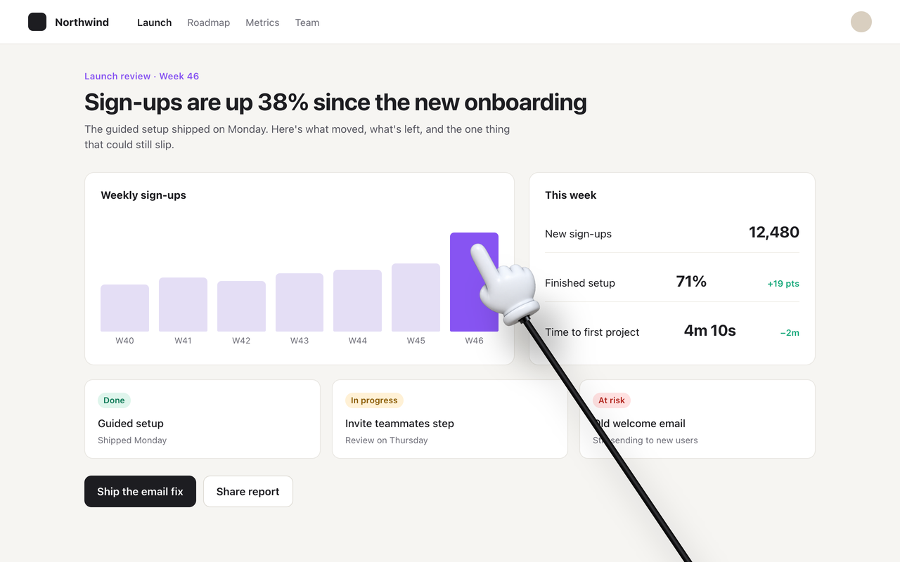

# TinyHand for Chrome

A tiny hand on a stick that points at things on any website, for demos,
screen shares and streams. It's an unofficial port of
[TinyHand](https://tinyhand.app), the free Mac app by
[Kamran Ahmed](https://kamran.fyi), to Chrome and other Chromium browsers. The
hands, the tap sounds and the way the hand moves are his.



- **Point.** 36 hands and a laser dot. The stick reaches up from below the
  window and swings as the pointer moves. Cursor glove is the default.
- **Tap.** Every click dips the hand, tucks its shadow in and plays a tap
  sound: 15 sounds, or off.
- **Draw.** Shift-drag draws on the page in the hand's ink colour. Hold ⌘
  (Ctrl elsewhere) as well to end with an arrow. Lines fade after 3 seconds,
  or stay until Esc.
- **Slap.** Hold ⌥ (Alt elsewhere) to outline the section under the hand;
  ⌥-click knocks it off the page, like VisBug's delete. ⌥Z puts the last one
  back; a reload brings everything back.
- **Settings.** Size (TinyHand's 10%, 13% or 17% of the screen height), shadow,
  ink colour, fade time, tap sound, and an off switch per site. ⌥⇧H turns the
  hand on or off; ⌥⇧T turns the tap sound on or off.

The Settings page shows the hand and has a practice area. It opens on first
install.

## Load it

1. Open `chrome://extensions`.
2. Turn on Developer mode.
3. Click "Load unpacked" and choose this folder.

There is no build step. `tools/package.sh` zips the files the extension loads
into `dist/` for the Chrome Web Store.

## How it works

The content script hides the real cursor in every frame with a user-origin
stylesheet (`cursor: none`), which a site's own cursor rules can't override,
and adopts the same rule into shadow roots. Chrome leaves that stylesheet in
open pages after an update or uninstall, so it only applies while `<html>`
carries an attribute that's random per copy of the script; a copy left behind
removes its attribute, overlay and slaps the next time the pointer moves. In the top frame it draws on two
canvases: the drawing underneath, and the hand on top with TinyHand's shadow
as a CSS drop shadow. The stick is held below the bottom edge and to the right
of the pointer and trails it, and the hand turns so its fingertip lands on the
pointer, using the numbers from TinyHand's `ArmView.swift`. Strokes follow its
`Ink.swift`.

The canvases sit in a closed shadow root on a manual popover. That keeps them
in the top layer above dialogs and fullscreen elements, and
`pointer-events: none` lets every click through.

Frames pass the pointer up to the top frame. A frame posts its parent a random
id, the parent claims that id with the service worker, and pointer events then
travel as extension messages, which pages can't read or forge.

A slap hides the element with `display: none`, not by removing it, so the
page's own scripts keep working. The page sees none of a slap's or a stroke's
mouse events.

Nothing leaves the browser. See [PRIVACY.md](PRIVACY.md).

## Differences from the Mac app

- Clicks still click. In TinyHand a click is only a tap.
- Drawing is Shift-drag, because a plain drag selects text in a browser.
- Slap is new; TinyHand has nothing like it.
- No toolbar and no custom hands.
- The hand only shows inside web pages, not over the browser's own UI or on
  pages extensions can't run on (`chrome://` pages, the Web Store).

## Test

`test/` has a calendar-like fixture with shadow roots, iframes and a head
rewrite, from Purrsor. Serve it on two ports, the second for the cross-origin
iframe, then run the checks. Each loads the extension in Playwright's Chrome
for Testing and writes screenshots to `out/`.

The checks need `playwright-core`, either installed in this folder
(`npm install --no-save playwright-core`) or found through `PLAYWRIGHT_CORE`, and
Chrome for Testing (`npx playwright install chromium`). `CHROMIUM` points them
at another Chrome binary.

```sh
python3 -m http.server 8741 --bind 127.0.0.1 -d test &
python3 -m http.server 8742 --bind 127.0.0.1 -d test &
node tools/smoke.mjs    # cursor hidden everywhere, hand drawn, on/off, dialogs
node tools/slap.mjs     # outline, slap, page sees no click, ⌥Z
node tools/draw.mjs     # strokes, arrow, fade, Esc, iframe, still Shift-click
node tools/inject.mjs   # a second injected copy changes nothing; no pointer data reaches the page
node tools/edges.mjs    # long drags, closed shadow roots, touch, blur, frame floods, rotated frames
node tools/update.mjs   # a real reload over an open tab, then off, then disabled
node tools/rapid.mjs    # quick ⌥-clicks knock off one element each, none snaps back; a slap dents around the click and ⌥Z restores in place, whatever the element's own transform
node --test tools/slap-motion.mjs   # the slap's timeline, without a browser
```

`EXT_DIR=path` runs them against another copy, such as the unzipped package.

The store images come from `tools/store-shots.mjs` with `store/` served on
port 8743.

## License

MIT. The hands, sounds and hand geometry are TinyHand's, MIT, © 2026 Kamran
Ahmed. Hiding the cursor on every site follows Purrsor by Lucie Haberer, MIT.
See [LICENSE](LICENSE).
